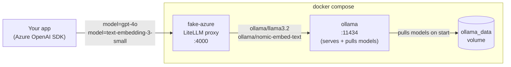

# local-azure

A local stand-in for Azure OpenAI. A [LiteLLM](https://github.com/BerriAI/litellm) proxy on `http://localhost:4000` accepts Azure OpenAI SDK requests and answers them with local [Ollama](https://ollama.com) models, so you can develop and test without an Azure subscription, network access or token costs.

| Fake Azure deployment    | Served by (Ollama)  |
|--------------------------|---------------------|
| `gpt-4o`                 | `llama3.2`          |
| `text-embedding-3-small` | `nomic-embed-text`  |

## Architecture



- Your app sends normal Azure OpenAI requests to `localhost:4000`, using a deployment name as `model`.
- `fake-azure` looks the deployment name up in `litellm_config.yaml` and forwards the request to the matching Ollama model.
- `ollama` runs the models, which are stored in the `ollama_data` volume. On every start it also downloads any models that are missing or out of date.
- Start order: `ollama` reports healthy only once both models are downloaded, and `fake-azure` waits for that before starting.

## Start the proxy

```bash
docker compose up -d
```

The first start downloads both models (a few GB), so it takes a while. The proxy waits until the download finishes. To follow progress:

```bash
docker compose logs -f ollama fake-azure
```

Check that everything works:

```bash
source .venv/bin/activate
python call_azure.py
```

You should see a chat reply followed by a line like `Embedding dims: 768, first 5: [...]`.

## Point an existing app at it

Your app's code doesn't need to change. Only its configuration does.

### 1. Endpoint and key

Set the Azure endpoint to the proxy. Any API key is accepted, but the SDK requires a non-empty value.

```bash
export AZURE_OPENAI_ENDPOINT=http://localhost:4000
export AZURE_OPENAI_API_KEY=fake-key
export OPENAI_API_VERSION=2024-10-21
```

The Python SDK reads these variables automatically, so `AzureOpenAI()` with no arguments works. If your app passes them explicitly:

```python
from openai import AzureOpenAI

client = AzureOpenAI(
    azure_endpoint="http://localhost:4000",
    api_key="fake-key",
    api_version="2024-10-21",
)
```

If your app runs inside a Docker container, `localhost` points at the container itself. Use `http://host.docker.internal:4000` instead.

### 2. Entra ID / managed identity

If your app authenticates with `azure_ad_token_provider` or `DefaultAzureCredential` instead of an API key, switch it to API-key auth for local runs. The proxy does not validate Entra ID tokens, and fetching one needs real Azure credentials.

### 3. Deployment names

Your app's deployment names must match a `model_name` in `litellm_config.yaml`. If your app uses deployments other than `gpt-4o` and `text-embedding-3-small`, add entries for them:

```yaml
model_list:
  - model_name: my-chat-deployment       # the name your app sends
    litellm_params:
      model: ollama/llama3.2
      api_base: http://ollama:11434      # container hostname, not localhost
```

If you map to an Ollama model that isn't downloaded yet, also update the `ollama` service in `docker-compose.yml` in two places: add an `ollama pull <model>` line to its `command`, and add `&& ollama show <model> >/dev/null` to its `healthcheck`. Without the health check entry, `fake-azure` may start before the new model has finished downloading. Then apply the changes:

```bash
docker compose up -d                  # downloads any new models
docker compose restart fake-azure     # reloads litellm_config.yaml
```

## Caveat: embeddings are 768-dimensional, not 1536

Real Azure `text-embedding-3-small` returns **1536** numbers per embedding by default. The local stand-in, `nomic-embed-text`, returns **768**. The API call succeeds either way, but anything that assumes a fixed vector size will break:

- **Vector stores and indexes** created with a fixed dimension, such as pgvector `vector(1536)`, Azure AI Search fields or Pinecone/Qdrant collections, will reject 768-dim vectors.
- **Existing embeddings** made by real Azure can't be compared with local ones. They come from different models, so similarity scores between them are meaningless even when the sizes match.
- **Hard-coded sizes** in code, schemas or tests, such as `assert len(v) == 1536`, will fail.
- **The `dimensions` parameter can shrink vectors but not enlarge them.** Asking for `dimensions=1536` fails with `400 ... dimensions 1536 exceeds embedding length 768`. Values of 768 or less work: `dimensions=256` returns 256 numbers.

What to do:

- Use a separate local vector store or index, created with dimension 768, and fill it with embeddings from the proxy. Never mix local and Azure embeddings in the same index.
- Read the vector size from config instead of hard-coding 1536, so the same code works in both environments.
- Or, if you control the request, pass `dimensions=768` (or smaller) in both environments. Real `text-embedding-3-small` also supports shortened vectors, so both sides then return the same size. The two models' vectors still can't be compared with each other.

## Other differences from real Azure

- **Response quality.** `llama3.2` is a small local model, far weaker than GPT-4o. Use the proxy to check how your app connects to and calls the API, not to judge answer quality.
- **Unsupported settings are ignored.** `drop_params: true` in `litellm_config.yaml` makes the proxy drop request settings Ollama doesn't support instead of failing. It's required because the SDK sends `encoding_format=base64` on every embeddings call, which Ollama rejects. The side effect is that some other settings your app sends may be ignored without an error, so a request can succeed locally but behave differently than on Azure.
- **No auth, quotas or content filtering.** The proxy runs without a master key. Keep port 4000 local and don't expose it.
